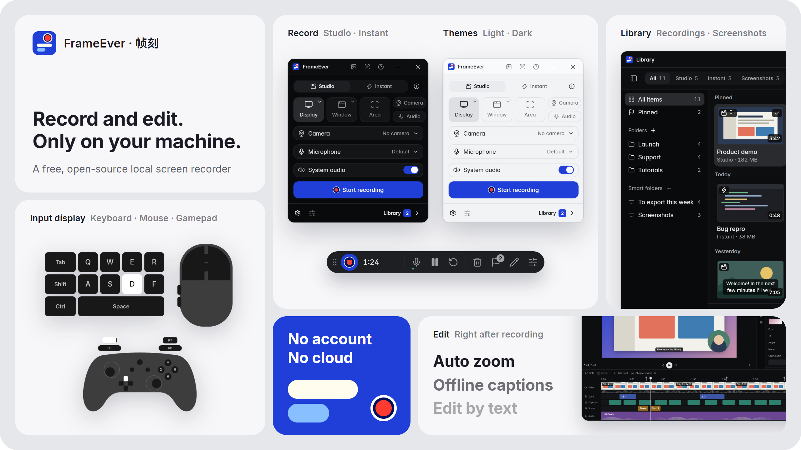
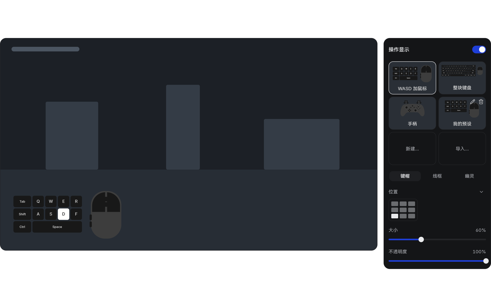
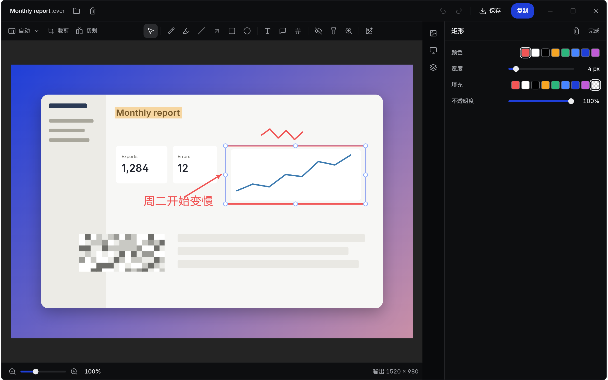

<div align="center">


# FrameEver · 帧刻

**A local-only screen recorder and editor. Free and open source, no account, no cloud.**

[](https://github.com/AniBullet/FrameEver/releases/latest)
[](https://github.com/AniBullet/FrameEver/releases)
[](https://github.com/AniBullet/FrameEver/stargazers)
[](https://github.com/AniBullet/FrameEver/forks)
[](https://github.com/AniBullet/FrameEver/issues)
[](https://github.com/AniBullet/FrameEver/commits/main)
[](https://github.com/AniBullet/FrameEver/actions/workflows/macos.yml)


[](LICENSE)

[简体中文](README.md) · **English**

[Download](#download) · [Highlights](#highlights) · [Features](#features) · [Privacy](#only-on-your-machine) · [Run from source](#run-from-source)

<br>



</div>

## Highlights

<table>
<tr>
<td width="50%" valign="top">

<p><b>Input display</b><br>Keyboard, mouse and gamepad light up as you press. Three built-in styles, or make your own preset.</p>
</td>
<td width="50%" valign="top">

<p><b>Edit by text</b><br>Offline transcript: delete words and the video is cut with them. Clear fillers and pauses in one pass.</p>
</td>
</tr>
<tr>
<td valign="top">

<p><b>Library</b><br>Recordings and screenshots in one place. Folders, filter, search, press Space to preview.</p>
</td>
<td valign="top">

<p><b>Screenshot annotation</b><br>Arrows, text, pixelate and numbered steps; add a background and copy.</p>
</td>
</tr>
<tr>
<td valign="top">

<p><b>Record any part</b><br>A display, a window or any area, with a locked ratio or snapped to a window.</p>
</td>
<td valign="top">

<p><b>Two ways to record</b><br>Studio opens the editor when you stop. Instant gives you a finished video.</p>
</td>
</tr>
</table>

## Features

<table>
<tr>
<th width="33%">Record</th>
<th width="34%">Edit</th>
<th width="33%">Keep</th>
</tr>
<tr>
<td valign="top">

- Display, window, area
- Audio only, exported as MP3 or WAV
- Camera overlay, background blur
- Microphone + system audio; switch devices while recording
- Keyboard, mouse and gamepad input
- On-screen drawing, chapter markers
- Teleprompter
- Global shortcuts, countdown, auto-stop
- Screenshots

</td>
<td valign="top">

- Auto zoom that follows the cursor
- Backgrounds, corners, shadows, cursor styling
- Split, speed, twelve transitions
- Offline captions with Whisper / Parakeet
- Edit by text, clear filler words
- Arrows, boxes, highlights, numbered steps
- Voice EQ, de-click
- Style presets, Enhance quality
- Export MP4 (H.264 / HEVC / AV1), GIF
- Export screen, camera and audio as separate tracks

</td>
<td valign="top">

- Recordings, screenshots and exports together
- Folders, pins, smart folders
- Filter, search, sort; Ctrl+K command palette
- Space to preview, step by frame, drag to scrub
- Compress to HEVC with visible progress; cancel any time
- A result card after each recording to export or copy
- Delete goes to the Recycle Bin
- Files sit in `Videos\FrameEver`
- [`frameever`](apps/cli/README.md) command line for scripts and AI agents

</td>
</tr>
</table>

## Download

| Platform | Get it |
| --- | --- |
| **Windows 10 / 11** (64-bit) | [`FrameEver_<version>_x64-setup.exe`](https://github.com/AniBullet/FrameEver/releases/latest); updates itself after that |
| **macOS** (Apple silicon) | [`.dmg`](https://github.com/AniBullet/FrameEver/releases/latest). Not verified on a real Mac, not signed |
| Linux | Not supported |

<details>
<summary>Opening it for the first time on macOS</summary>

<br>

Open it once, then choose Open Anyway in System Settings → Privacy & Security. After every update you grant screen recording, camera and microphone access again.

</details>

<details>
<summary>Moving from Cap-aniBullet 2.x or Cap</summary>

<br>

Download FrameEver Converter from [Releases](https://github.com/AniBullet/FrameEver/releases/latest). It finds your old settings, recordings and screenshots, shows what it will convert, then moves them into FrameEver's storage folder.

</details>

## Only on your machine

No server, no account, no cloud storage. FrameEver uses the network in three cases only, and never sends your content:

1. Checking for and downloading updates
2. Downloading a caption model the first time you use captions
3. Links you click

<details>
<summary>Where it connects</summary>

<br>

The app's own requests are HTTPS GET only, to these hosts:

| Host | Used for |
| --- | --- |
| `github.com` | Update checks and downloads, caption model downloads |
| `api.github.com` | Reading this repository's releases |
| `release-assets.githubusercontent.com`, `objects.githubusercontent.com` | Downloads that GitHub redirects |

A request carries the resource address, a User-Agent and the metadata a connection needs (DNS, TLS, IP address). It has no body and sends no recordings, screenshots, projects, captions, window titles, file paths or logs.

A `RunCommand` automation rule runs a command you wrote, so its network use is up to that command. The storage folder cannot be in a cloud drive; for a cloud backup, copy your exported files there.

</details>

## Input record

A Studio recording saves which keys, mouse buttons and wheel steps you pressed, and when, to draw the input display. It stays on this PC, and you can switch it off or clear it.

<details>
<summary>Where it is kept, how it is read, how to switch it off</summary>

<br>

- **Where it is kept.** In two files in each take's folder inside the project, `keyboard.bin` and `input.bin`. FrameEver never sends them anywhere. The `frameever` command and the AI-agent tools do not return them, or the text of keyboard segments. A diagnostic report says only whether the switch is on.
- **When it is read.** Only while a recording runs. FrameEver asks Windows which keys and buttons are down about 60 times a second, and reads wheel steps from Windows Raw Input. It installs no keyboard hook and no driver, and injects nothing into other programs.
- **One window.** When you record a single window, the input display shows only what you pressed while that window was in front.
- **Switching it off.** Settings → Recording → Record input. With it off, a new recording reads and saves no input, from the app or from the `frameever` command.
- **Clearing it.** In the editor's title bar, Clear input record removes it from that project, together with the project's keyboard segments, and keeps the recording. This can't be undone.

An exported video contains only what the input display drew. Mouse clicks that drive the cursor effects belong to the cursor data saved by Separate cursor, not to the input record.

</details>

## Run from source

```powershell
pnpm fe setup
pnpm fe dev
```

Rust + [GPUI](https://www.gpui.rs) + FFmpeg, with about 2,000 automated tests.

[Build guide](BUILD.md) · [Contributing](CONTRIBUTING.md) · [Changelog](CHANGELOG.md) · [Glossary](GLOSSARY.md) · [Decisions](docs/adr) · [Design pages](docs/design) · [Report an issue](https://github.com/AniBullet/FrameEver/issues/new)

## Star history

<div align="center">

<a href="https://star-history.com/#AniBullet/FrameEver&Date">
<picture>
<source media="(prefers-color-scheme: dark)" srcset="https://api.star-history.com/svg?repos=anibullet/frameever&type=Date&theme=dark" />

</picture>
</a>

</div>

## Origin and license

FrameEver started from [Cap](https://github.com/CapSoftware/Cap), removed every cloud feature, gained a native interface and is now developed independently. It is not affiliated with Cap and does not use Cap's name or logo.

**AGPL-3.0** ([LICENSE](LICENSE)); the `frameever-camera*` and `scap-*` crates are MIT ([licenses/LICENSE-MIT](licenses/LICENSE-MIT)).

Thanks to the Cap team and every contributor, and to [GPUI](https://www.gpui.rs), [FFmpeg](https://ffmpeg.org), [Whisper](https://github.com/openai/whisper), Parakeet, [Lucide](https://lucide.dev), [Tabler](https://tabler.io/icons), [Inter](https://rsms.me/inter/) and [HarmonyOS Sans](https://developer.huawei.com/consumer/cn/design/resource/).

<sub>The pictures are rendered from the design pages ([`docs/design`](docs/design)), which the app is built to match, and show the Chinese interface.</sub>

<br>

<div align="center">

**A moment, kept forever**

If FrameEver helps you, a ⭐ means a lot

</div>
