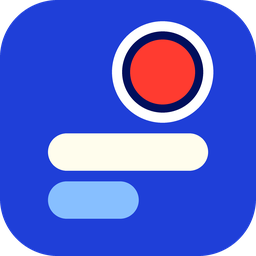
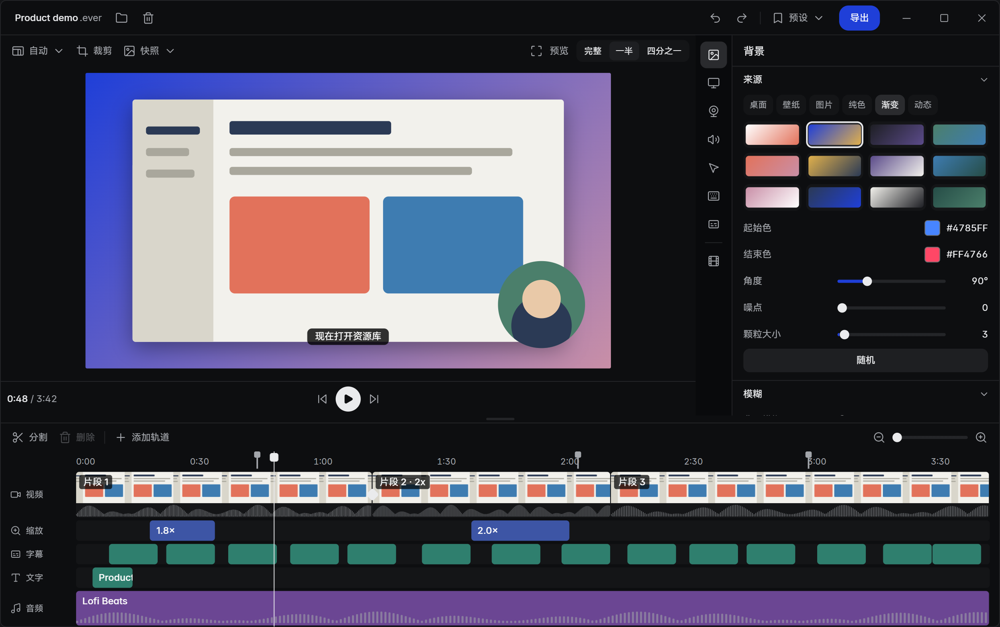
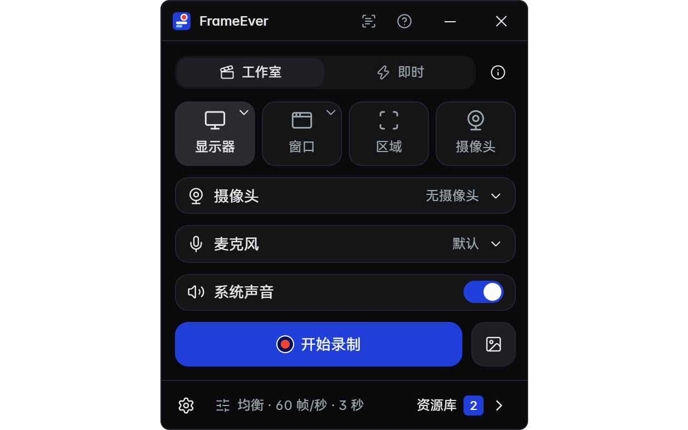
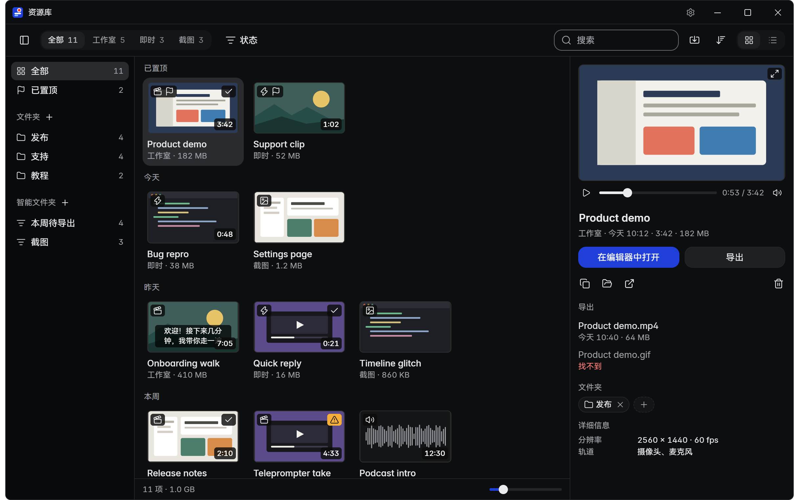

<div align="center">



# FrameEver · 帧刻

### A local-only screen recorder and editor

A library with previews, offline captions and a key display, in one native app.<br>
Free and open source, and everything stays on your machine.

<br>

[](https://github.com/AniBullet/FrameEver/releases)
[](https://github.com/AniBullet/FrameEver/releases)
[](https://github.com/AniBullet/FrameEver/stargazers)
[](LICENSE)

[简体中文](README.md) · **English**

<br>



</div>

<br>

> [!NOTE]
> **1.0.0 is in development and not released yet.** To try it now, [run it from source](#run-from-source); [Releases](https://github.com/AniBullet/FrameEver/releases) currently holds the older 2.x. The pictures here are rendered from the design pages ([`docs/design`](docs/design)), which the app is built to match, and show the Chinese interface.

<br>

## Record



A small window: choose what to record and press Start.

- **Studio** opens the editor when you stop; **Instant** gives you a finished video
- A display, a window or any area, with a camera overlay and background blur
- Microphone and system audio together
- Draw on screen, add chapter markers and read a teleprompter while recording
- Global shortcuts, a countdown and auto-stop after a set time
- A small button beside Start takes a screenshot, which you can annotate and give a background

<br clear="right" />

## Edit

No second app, and no editing skills needed.

- **Auto zoom** follows the cursor and enlarges what matters
- Backgrounds, rounded corners, shadows, cursor styling and a key display
- Split, delete and copy clips on the timeline, add transitions, step frame by frame
- **Local captions**: Whisper or Parakeet, offline, editable line by line
- Export MP4 (H.264 / HEVC / AV1) or GIF; HEVC and AV1 files are a third to a quarter the size of H.264

## Keep

<div align="center">

</div>

<br>

Everything you recorded is in the library, screenshots included.

- Filter by type, search and sort, as a grid or a list
- Press Space to preview, hover to scrub
- Compress Instant recordings to HEVC and switch between the original and the compressed copy
- Deleting goes to the Recycle Bin and can be undone
- The files sit in your `Videos\FrameEver` folder, yours to move or back up

<br>

## Only on your machine

No server, no account, no cloud storage. Recording, editing, captions and compression all run locally.

FrameEver uses the network in three cases only, and never sends your content:

1. Checking for and downloading updates
2. Downloading a caption model the first time you use captions
3. Links you click

<details>
<summary>Where it connects</summary>

<br>

The app's own requests are HTTPS GET only, to these hosts:

| Host | Used for |
| --- | --- |
| `github.com` | Update checks and downloads, caption model downloads |
| `api.github.com` | Reading this repository's releases |
| `release-assets.githubusercontent.com`, `objects.githubusercontent.com` | Downloads that GitHub redirects |

A request carries the resource address, a User-Agent and the metadata a connection needs (DNS, TLS, IP address). It has no body and sends no recordings, screenshots, projects, captions, window titles, file paths or logs.

A `RunCommand` automation rule runs a command you wrote, so its network use is up to that command. The storage folder cannot be in a cloud drive; for a cloud backup, copy your exported files there.

</details>

## Input record

A Studio recording saves which keys, mouse buttons and wheel steps you pressed, and when. The editor uses this input record to light them up on a keyboard and mouse picture (the input display) and to make keyboard segments.

- **Where it is kept.** In two files in each take's folder inside the project, `keyboard.bin` and `input.bin`, on this PC. FrameEver never sends them anywhere. The `frameever` command and the AI-agent tools do not return them, or the text of keyboard segments. A diagnostic report says only whether the switch is on.
- **When it is read.** Only while a recording runs. FrameEver asks Windows which keys and buttons are down about 60 times a second, and reads wheel steps from Windows Raw Input. It installs no keyboard hook and no driver, and injects nothing into other programs.
- **One window.** When you record a single window, the input display shows only what you pressed while that window was in front.
- **Switching it off.** Settings → Recording → Record input. With it off, a new recording reads and saves no input, from the app or from the `frameever` command.
- **Clearing it.** In the editor's title bar, Clear input record removes it from that project, together with the project's keyboard segments, and keeps the recording. This can't be undone.

An exported video contains only what the input display drew. Mouse clicks that drive the cursor effects belong to the cursor data saved by Separate cursor, not to the input record.

## Download

| Platform | Status |
| --- | --- |
| **Windows 10 / 11** (64-bit) | Once 1.0.0 is released, download `FrameEver_<version>_x64-setup.exe` from [Releases](https://github.com/AniBullet/FrameEver/releases); the app checks for updates itself after that |
| **macOS** (Apple silicon) | A `.dmg` comes with 1.0.0. It is built, tested and packaged in CI, has not run on a real Mac, and has no Apple Developer signature |
| Linux | Not supported |

<details>
<summary>Opening it for the first time on macOS</summary>

<br>

macOS blocks unsigned apps: open it once, then choose Open Anyway in System Settings → Privacy & Security. After every update you grant screen recording, camera and microphone access again.

</details>

<details>
<summary>Moving from Cap-aniBullet 2.x or Cap</summary>

<br>

FrameEver Converter, a separate download, finds your old settings, recordings and screenshots, shows you what it will convert, then moves them into FrameEver's storage folder.

</details>

## For scripts and AI agents

The `frameever` command-line tool records, exports and manages projects for scripts, automation rules and AI agents. See [apps/cli/README.md](apps/cli/README.md).

## Run from source

```powershell
pnpm fe setup     # prepare the machine (first time)
pnpm fe dev       # run the app on separate test data
```

Written in Rust; the interface is drawn on the GPU with [GPUI](https://www.gpui.rs), and media goes through FFmpeg. About 2,000 automated tests run on Windows and macOS.

[Build guide](BUILD.md) · [Contributing](CONTRIBUTING.md) · [Changelog](CHANGELOG.md) · [Glossary](GLOSSARY.md) · [Decisions](docs/adr) · [Report an issue](https://github.com/AniBullet/FrameEver/issues/new)

## Origin and license

FrameEver started from [Cap](https://github.com/CapSoftware/Cap), removed every cloud feature, gained a native interface and is now developed independently. It is not affiliated with Cap and does not use Cap's name or logo.

Open source under **AGPL-3.0** ([LICENSE](LICENSE)); the `frameever-camera*` and `scap-*` crates are MIT ([licenses/LICENSE-MIT](licenses/LICENSE-MIT)).

Thanks to the Cap team and every contributor, and to [GPUI](https://www.gpui.rs), [FFmpeg](https://ffmpeg.org), [Whisper](https://github.com/openai/whisper), Parakeet, [Lucide](https://lucide.dev), [Tabler](https://tabler.io/icons), [Inter](https://rsms.me/inter/) and [HarmonyOS Sans](https://developer.huawei.com/consumer/cn/design/resource/).

<br>

<div align="center">

**A moment, kept forever**

If FrameEver helps you, a ⭐ means a lot

</div>
