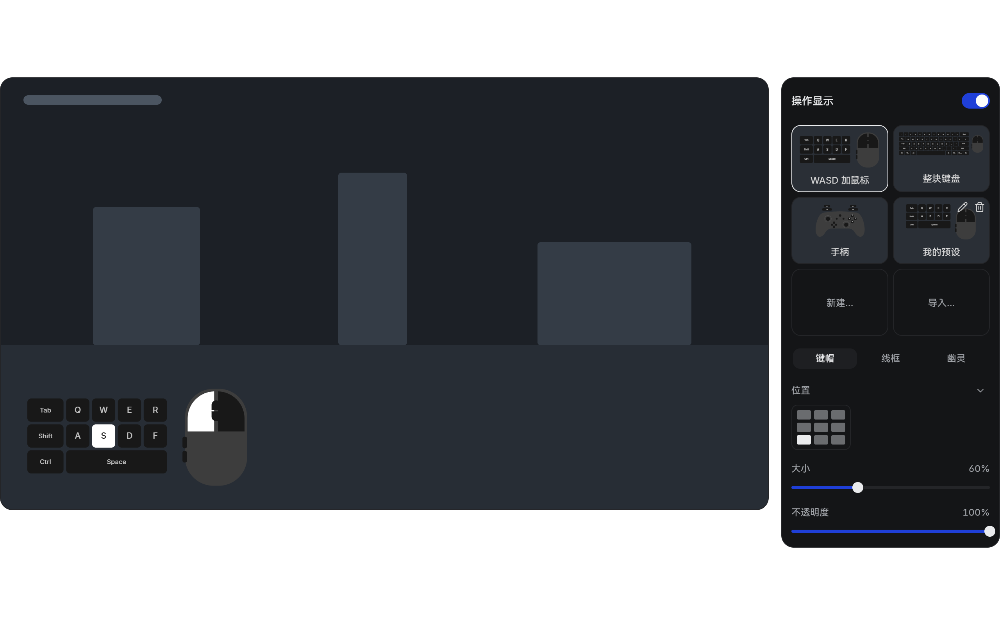
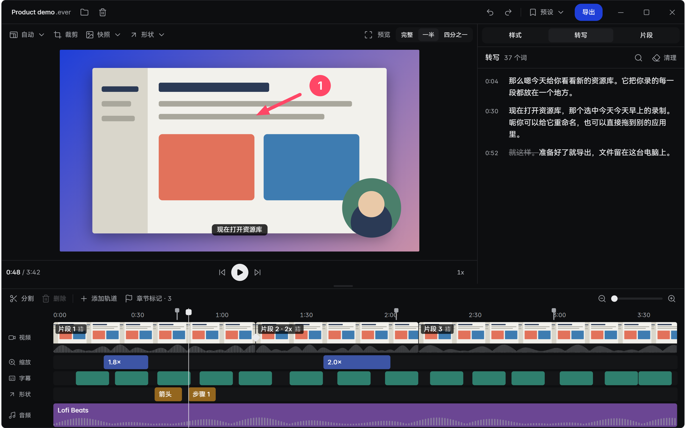
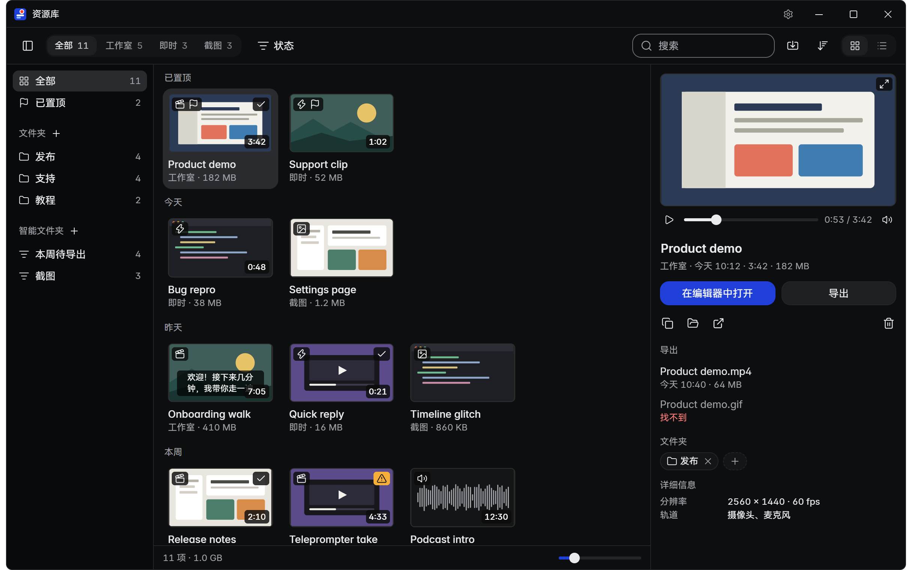
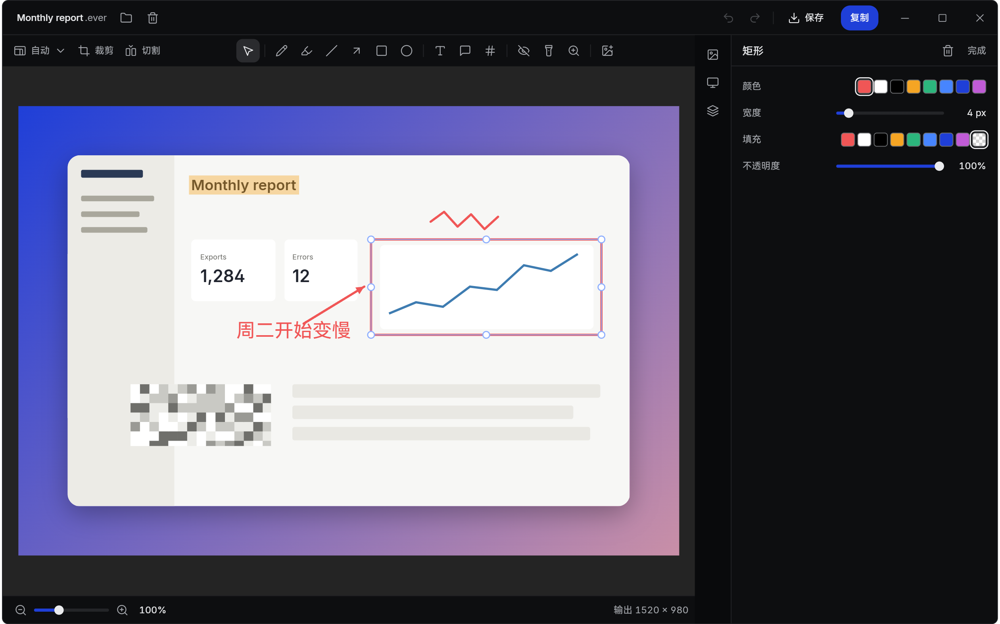
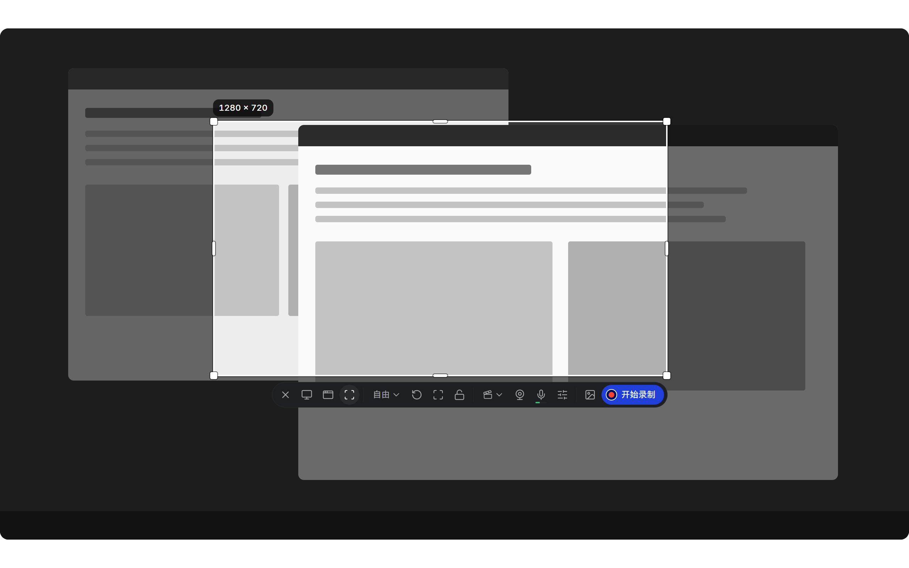
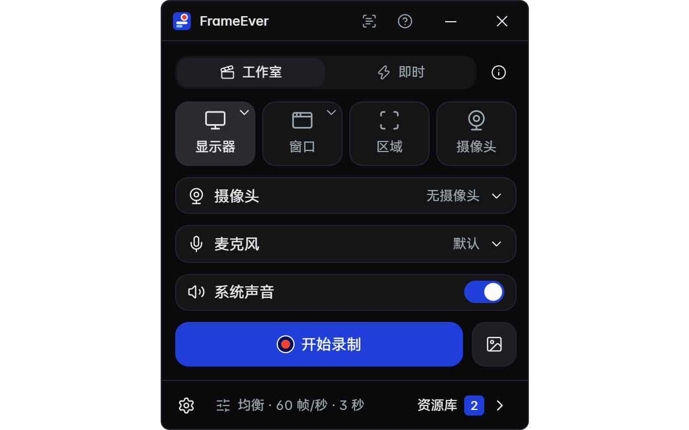

<div align="center">


# FrameEver · 帧刻

**纯本地的录屏与剪辑工具。免费开源，没有账号，没有云。**

[](https://github.com/AniBullet/FrameEver/releases/latest)
[](https://github.com/AniBullet/FrameEver/releases)
[](https://github.com/AniBullet/FrameEver/stargazers)
[](https://github.com/AniBullet/FrameEver/forks)
[](https://github.com/AniBullet/FrameEver/issues)
[](https://github.com/AniBullet/FrameEver/commits/main)
[](https://github.com/AniBullet/FrameEver/actions/workflows/macos.yml)


[](LICENSE)

**简体中文** · [English](README.en.md)

[下载](#下载) · [亮点](#亮点) · [功能](#功能) · [隐私](#只在你的电脑上) · [从源码运行](#从源码运行)

<br>


</div>

## 亮点

<table>
<tr>
<td width="50%" valign="top">

<p><b>操作显示</b><br>键盘、鼠标、手柄，按下哪个亮哪个。自带三种样式，也能自己做预设。</p>
</td>
<td width="50%" valign="top">

<p><b>按文字剪</b><br>离线转写，删掉几个词，视频跟着剪。语气词和停顿一次清掉。</p>
</td>
</tr>
<tr>
<td valign="top">

<p><b>资源库</b><br>录制和截图都在这里。筛选、搜索，按 Space 预览。</p>
</td>
<td valign="top">

<p><b>截图标注</b><br>箭头、文字、马赛克、步骤编号，加背景后直接复制。</p>
</td>
</tr>
<tr>
<td valign="top">

<p><b>选哪录哪</b><br>显示器、窗口或任意区域，可锁比例、贴合窗口。</p>
</td>
<td valign="top">

<p><b>两种录法</b><br>工作室：录完进编辑器。即时：停下就是成片。</p>
</td>
</tr>
</table>

## 功能

<table>
<tr>
<th width="33%">录</th>
<th width="34%">剪</th>
<th width="33%">存</th>
</tr>
<tr>
<td valign="top">

- 显示器、窗口、区域
- 摄像头叠加、背景虚化
- 麦克风 + 系统声音
- 记录键盘、鼠标、手柄
- 屏幕画笔、章节标记
- 提词器
- 全局快捷键、倒计时、定时停止
- 截图

</td>
<td valign="top">

- 自动缩放跟随光标
- 背景、圆角、阴影、光标美化
- 分割、变速、十二种转场
- Whisper / Parakeet 离线字幕
- 按文字剪、清理语气词
- 箭头、方框、高亮、步骤编号
- 人声 EQ、去口水音
- 样式预设
- 导出 MP4（H.264 / HEVC / AV1）、GIF

</td>
<td valign="top">

- 录制、截图、导出放在一起
- 筛选、搜索、排序
- Space 预览、悬停拖看
- 即时录制压缩成 HEVC
- 删除进回收站
- 文件就在 `视频\FrameEver`
- 命令行 [`frameever`](apps/cli/README.md)，给脚本和 AI 用

</td>
</tr>
</table>

## 下载

| 平台 | 获取 |
| --- | --- |
| **Windows 10 / 11**（64 位） | [`FrameEver_<版本>_x64-setup.exe`](https://github.com/AniBullet/FrameEver/releases/latest)，之后自动更新 |
| **macOS**（Apple 芯片） | [`.dmg`](https://github.com/AniBullet/FrameEver/releases/latest)。未在真机验证，未签名 |
| Linux | 不支持 |

<details>
<summary>macOS 第一次打开</summary>

<br>

先打开一次，再到“系统设置 → 隐私与安全性”点“仍要打开”。每次更新后要重新授予屏幕录制、摄像头和麦克风权限。

</details>

<details>
<summary>从 Cap-aniBullet 2.x 或 Cap 搬过来</summary>

<br>

在 [Releases](https://github.com/AniBullet/FrameEver/releases/latest) 下载 FrameEver Converter。它找到旧的设置、录制和截图，预览后转进 FrameEver 的存储文件夹。

</details>

## 只在你的电脑上

没有服务器、账号和云存储。只在三种情况下联网，从不发送你的内容：

1. 检查和下载更新
2. 首次使用字幕时下载识别模型
3. 你自己点开的链接

<details>
<summary>具体连到哪里</summary>

<br>

应用内置的请求只用 HTTPS GET，限于以下主机：

| 主机 | 用途 |
| --- | --- |
| `github.com` | 检查和下载更新、下载字幕识别模型 |
| `api.github.com` | 查询本仓库的发布版本 |
| `release-assets.githubusercontent.com`、`objects.githubusercontent.com` | 接收 GitHub 重定向后的下载 |

请求只带资源地址、User-Agent 和建立连接所需的元数据（DNS、TLS、IP 地址），没有请求正文，不发送录制、截图、项目、字幕、窗口标题、文件路径或日志。

`RunCommand` 自动化规则运行的是你自己写的命令，是否联网由这些命令决定。存储文件夹不支持放在云盘里；需要云端备份时，把导出的文件复制过去。

</details>

## 操作记录

工作室录制会保存按过的键、鼠标按键、滚轮和时间，用来画操作显示。只存在这台电脑上，可以关闭，也可以清除。

<details>
<summary>存在哪里、怎么读取、怎么关</summary>

<br>

- **存在哪里。** 项目里每段录制的文件夹中有两个文件：`keyboard.bin` 和 `input.bin`。FrameEver 不会把它们发到任何地方；`frameever` 命令和给 AI 用的工具不返回它们，也不返回按键片段的文字；诊断报告只写这个开关是开还是关。
- **什么时候读取。** 只在录制期间。FrameEver 每秒约 60 次向 Windows 查询哪些键和按键被按下，滚轮通过 Windows Raw Input 读取。不安装键盘钩子，不装驱动，也不向其他程序注入任何东西。
- **只录一个窗口时。** 操作显示只显示这个窗口在最前面时按下的内容。
- **关掉它。** 设置 → 录制 → 记录操作输入。关闭后，新的录制不读取也不保存任何输入，应用和 `frameever` 命令都一样。
- **清除它。** 在编辑器标题栏点“清除操作记录”，会从这个项目里删掉操作记录和按键片段，录制本身保留。此操作无法撤销。

导出的视频里只有操作显示画出来的内容。用于光标效果的鼠标点击属于“单独捕获光标”保存的光标数据，不在操作记录里。

</details>

## 从源码运行

```powershell
pnpm fe setup
pnpm fe dev
```

Rust + [GPUI](https://www.gpui.rs) + FFmpeg，约 2,000 个自动化测试。

[构建说明](BUILD.md) · [贡献指南](CONTRIBUTING.md) · [更新日志](CHANGELOG.md) · [术语](GLOSSARY.md) · [设计决策](docs/adr) · [设计稿](docs/design) · [反馈问题](https://github.com/AniBullet/FrameEver/issues/new)

## Star 趋势

<div align="center">

<a href="https://star-history.com/#AniBullet/FrameEver&Date">
<picture>
<source media="(prefers-color-scheme: dark)" srcset="https://api.star-history.com/svg?repos=anibullet/frameever&type=Date&theme=dark" />

</picture>
</a>

</div>

## 来历与协议

从 [Cap](https://github.com/CapSoftware/Cap) 分出，去掉全部云端功能，换上原生界面，现在独立开发。与 Cap 官方无关，不使用 Cap 的名称和标志。

**AGPL-3.0**（[LICENSE](LICENSE)）；`frameever-camera*` 和 `scap-*` 模块为 MIT（[licenses/LICENSE-MIT](licenses/LICENSE-MIT)）。

感谢 Cap 团队和所有贡献者，以及 [GPUI](https://www.gpui.rs)、[FFmpeg](https://ffmpeg.org)、[Whisper](https://github.com/openai/whisper)、Parakeet、[Lucide](https://lucide.dev)、[Tabler](https://tabler.io/icons)、[Inter](https://rsms.me/inter/) 和 [HarmonyOS Sans](https://developer.huawei.com/consumer/cn/design/resource/)。

<sub>本页的图由设计稿（[`docs/design`](docs/design)）渲染，应用照着它实现。</sub>

<br>

<div align="center">

**一刻，凝成永恒**

觉得好用，点个 ⭐ 就是最大的支持

<details>
<summary>☕ 请作者喝杯咖啡</summary>
<br>

<br>
<sub>微信 WeChat</sub>
</details>

</div>
