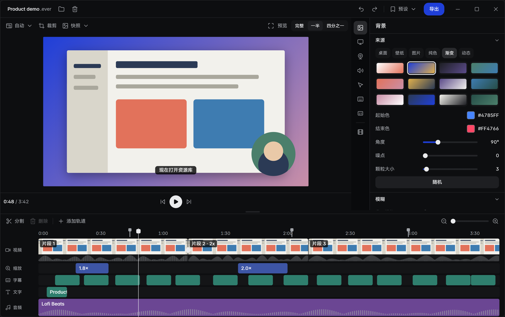

<div align="center">


# FrameEver · 帧刻

### 纯本地的录屏与剪辑工具

资源库预览管理、离线字幕、按键显示，一个原生应用做完。<br>
免费开源，一切只在你的电脑上。

<br>

[](https://github.com/AniBullet/FrameEver/releases)
[](https://github.com/AniBullet/FrameEver/releases)
[](https://github.com/AniBullet/FrameEver/stargazers)
[](LICENSE)

**简体中文** · [English](README.en.md)

<br>



</div>

<br>

> [!NOTE]
> **1.0.0 还在开发，尚未发布。** 想先试可以[从源码运行](#从源码运行)；[Releases](https://github.com/AniBullet/FrameEver/releases) 里目前是旧的 2.x。本页的图由设计稿（[`docs/design`](docs/design)）渲染，应用照着它实现。

<br>

## 录


一个小窗口，选好录什么，按下开始。

- **工作室**录完进编辑器精修，**即时**录完就是成片
- 显示器、窗口或任意区域，可叠加摄像头和背景虚化
- 麦克风和系统声音一起录
- 录的时候能在屏幕上画、打章节标记、看提词器
- 全局快捷键、倒计时、定时自动停止
- 旁边的小按钮顺手截图，截完可以标注、加背景

<br clear="right" />

## 剪

录完不用换软件，也不用会剪辑。

- **自动缩放**跟着光标走，重点自己放大
- 背景、圆角、阴影、光标美化、按键显示，一键变好看
- 时间轴上分割、删除、复制片段，加转场，逐帧对齐
- **本地字幕**：Whisper 或 Parakeet 离线识别，逐句可改
- 导出 MP4（H.264 / HEVC / AV1）或 GIF；HEVC 和 AV1 的文件只有 H.264 的 1/3 到 1/4

## 存

<div align="center">

</div>

<br>

录过的都在资源库里，截图也在。

- 按类型筛选，搜索，排序，网格或列表
- 按 Space 预览，鼠标悬停拖看
- 即时录制可压缩成 HEVC，原版和压缩版随时切换
- 删除进回收站，可撤销
- 文件就在 `视频\FrameEver` 文件夹里，想搬想备份都随你

<br>

## 只在你的电脑上

没有服务器，没有账号，没有云存储。录制、剪辑、字幕识别和压缩都在本机完成。

FrameEver 只在三种情况下联网，而且从不发送你的内容：

1. 检查和下载更新
2. 首次使用字幕时下载识别模型
3. 你自己点开的链接

<details>
<summary>具体连到哪里</summary>

<br>

应用内置的请求只用 HTTPS GET，限于以下主机：

| 主机 | 用途 |
| --- | --- |
| `github.com` | 检查和下载更新、下载字幕识别模型 |
| `api.github.com` | 查询本仓库的发布版本 |
| `release-assets.githubusercontent.com`、`objects.githubusercontent.com` | 接收 GitHub 重定向后的下载 |

请求只带资源地址、User-Agent 和建立连接所需的元数据（DNS、TLS、IP 地址），没有请求正文，不发送录制、截图、项目、字幕、窗口标题、文件路径或日志。

`RunCommand` 自动化规则运行的是你自己写的命令，是否联网由这些命令决定。存储文件夹不支持放在云盘里；需要云端备份时，把导出的文件复制过去。

</details>

## 下载

| 平台 | 状态 |
| --- | --- |
| **Windows 10 / 11**（64 位） | 1.0.0 发布后在 [Releases](https://github.com/AniBullet/FrameEver/releases) 下载 `FrameEver_<版本>_x64-setup.exe`，之后应用自己检查更新 |
| **macOS**（Apple 芯片） | 随 1.0.0 提供 `.dmg`。由 CI 编译、测试和打包，还没在真机上验证，也没有 Apple 开发者签名 |
| Linux | 不支持 |

<details>
<summary>macOS 第一次打开</summary>

<br>

系统会拦下未签名的应用：先打开一次，再到“系统设置 → 隐私与安全性”点“仍要打开”。每次更新后要重新授予屏幕录制、摄像头和麦克风权限。

</details>

<details>
<summary>从 Cap-aniBullet 2.x 或 Cap 搬过来</summary>

<br>

单独下载的 FrameEver Converter 会找到旧的设置、录制和截图，先让你预览，再转进 FrameEver 的存储文件夹。

</details>

## 给脚本和 AI 用

命令行工具 `frameever` 能录制、导出和管理项目，供脚本、自动化规则和 AI 智能体调用。见 [apps/cli/README.md](apps/cli/README.md)。

## 从源码运行

```powershell
pnpm fe setup     # 准备开发环境（首次）
pnpm fe dev       # 运行应用，用独立的测试数据
```

Rust 编写，界面用 [GPUI](https://www.gpui.rs) 直接在 GPU 上绘制，音视频用 FFmpeg。约 2,000 个自动化测试，在 Windows 和 macOS 上运行。

[构建说明](BUILD.md) · [贡献指南](CONTRIBUTING.md) · [更新日志](CHANGELOG.md) · [术语](GLOSSARY.md) · [设计决策](docs/adr) · [反馈问题](https://github.com/AniBullet/FrameEver/issues/new)

## 来历与协议

FrameEver 从 [Cap](https://github.com/CapSoftware/Cap) 分出，去掉了全部云端功能，换上原生界面，现在独立开发。它与 Cap 官方无关，不使用 Cap 的名称和标志。

以 **AGPL-3.0** 开源（[LICENSE](LICENSE)）；`frameever-camera*` 和 `scap-*` 模块为 MIT（[licenses/LICENSE-MIT](licenses/LICENSE-MIT)）。

感谢 Cap 团队和所有贡献者，以及 [GPUI](https://www.gpui.rs)、[FFmpeg](https://ffmpeg.org)、[Whisper](https://github.com/openai/whisper)、Parakeet、[Lucide](https://lucide.dev)、[Tabler](https://tabler.io/icons)、[Inter](https://rsms.me/inter/) 和 [HarmonyOS Sans](https://developer.huawei.com/consumer/cn/design/resource/)。

<br>

<div align="center">

**一刻，凝成永恒**

觉得好用，点个 ⭐ 就是最大的支持

<details>
<summary>☕ 请作者喝杯咖啡</summary>
<br>

<br>
<sub>微信 WeChat</sub>
</details>

</div>
